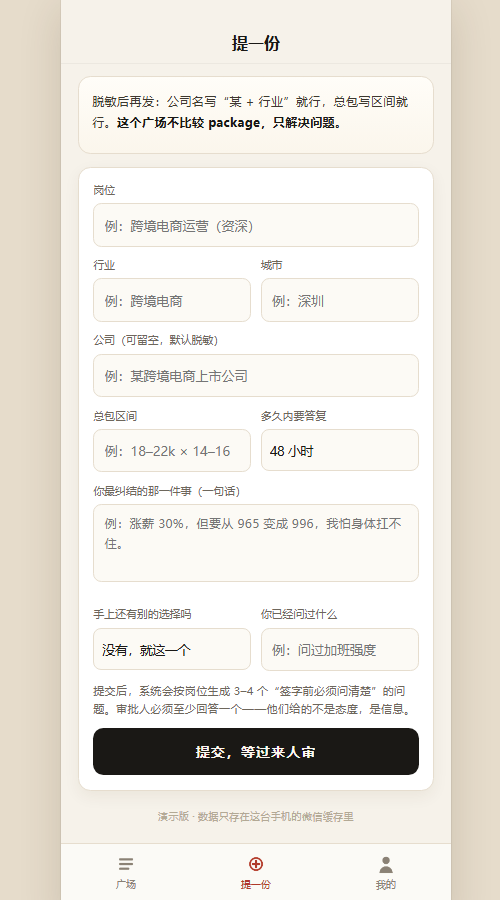

# offer 请等等

> **签字之前，先让过来人问三个问题。**
>
> 一个帮大学生和年轻职场人做「offer 决策」的微信小程序：把纠结脱敏发出来，陌生人判「接 / 再等等 / 别接」，并且必须回答一个你没想到要问的问题。最后拿到的不是一句结论，而是一张**签字前必须问清楚的清单**。


---

## 为什么做这个

拿到 offer 的那几天，是一个人最没有判断力的时候：

- **动作不可逆**：点了接受就拒掉其他机会、放弃应届生身份窗口，签了三方还有违约金；
- **身边人不可用**：朋友替你高兴，不替你判断；父母只看稳不稳定；同学可能是同岗位的竞争者，根本不能问；
- **缺的不是意志力，是信息**：不知道该问什么，比不敢决定更致命。

消费类产品解决的是「管不住手」，这里要解决的是「不知道该问什么」。所以产品的重心不是投票，而是**提问**。

## 怎么工作的

```
脱敏提交  →  系统按岗位生成 3–4 个必答问题  →  陌生人来审（三态 + 必写理由 + 至少答一题）
        →  结果不是结论，是行动清单  →  自己做决定  →  90 天后复盘
```

四个不能动的设计：

| 设计 | 为什么 |
|---|---|
| **三态判决**：接 / 再等等 / 别接 | 二元会逼人在没有信息时签字，而正确动作大概率是「先去补信息」 |
| **必须回答至少一个问题** | 只表态的审批没有信息增量，理由和答案才是交付物 |
| **先投后看** | 未投票时连票型都不返回，看到就会带节奏 |
| **作者满 3 票才解锁理由** | 避免被一两条意见带跑 |

还有一条反常识的规则：**作者不能给自己的 offer 投票**。作者已经提交完了，看理由不会污染任何判断，所以单独开一个「作者视角」，满 3 票解锁。


## 现在有什么

这个仓库里有两个东西：

| 目录 | 是什么 | 状态 |
|---|---|---|
| `offer-please-wait-mp/` | **微信小程序 + 云函数后端**（主） | 可运行，前后端已打通 |
| `offer-please-wait/` | 最早的 H5 原型 | 存档，不再维护 |

主项目已经做到：

- **小程序**：广场流、提交、审批、结果、决定、复盘，四个页面，三态齐全（loading / error / empty）；
- **后端**：微信云开发（云函数 + 云数据库），12 个接口，内容安全、配额账本、举报、审核队列、定时对账；
- **本地开发链路**：没有云环境也能跑——真后端跑成 HTTP 服务，页面用自研预览器在浏览器里渲染真实 WXML；
- **测试**：72 条后端断言 + 46 条页面断言，都不需要开发者工具和云环境。



## 技术栈

- 小程序：原生 WXML / WXSS / JS（无框架，包体小）
- 后端：微信云开发云函数（Node.js），单一入口 + service / repo 分层
- 数据：云数据库 10 个集合，关系型设计，关键约束用唯一索引兜底
- 本地：Node 18+ 即可，零依赖

## 快速开始

```bash
# 1) 后端：跑的是 cloudfunctions/api 的真实代码，文件持久化
node offer-please-wait-mp/dev/local-backend/server.js     # → 127.0.0.1:8898

# 2) 页面：把真实 WXML/WXSS/页面 JS 拿到浏览器里渲染
node offer-please-wait-mp/dev/preview/serve.js            # → 127.0.0.1:8899
```

打开 `http://127.0.0.1:8899/dev/preview/preview.html`，就是连着真后端的界面。

想看「两个人互相审」，开两个窗口，把 `?me=` 换成不同身份：

```
http://127.0.0.1:8899/dev/preview/preview.html?me=openid-A#/pages/plaza/plaza
http://127.0.0.1:8899/dev/preview/preview.html?me=openid-B#/pages/plaza/plaza
```

完整的分步说明（含微信开发者工具、连真实云开发、常见问题）见 **[docs/GETTING-STARTED.md](docs/GETTING-STARTED.md)**。

```bash
# 测试
node offer-please-wait-mp/dev/test-backend.js    # 72 条：视角隔离、一人一票、配额、内容安全、举报、对账
node offer-please-wait-mp/dev/simulate.js        # 46 条：页面三态、审批链路、作者视角、WXML 字段对账
```

## 目录

```
.
├── README.md                        ← 你在这里
├── docs/
│   ├── GETTING-STARTED.md           启动流程（本地 / 开发者工具 / 云开发）
│   ├── backend-plan.md              后端方案：选型、数据模型、接口、排期
│   └── screenshots/
├── offer-please-wait-mp/            小程序 + 云函数
│   ├── pages/                       四个页面
│   ├── utils/                       数据入口与降级
│   ├── cloudfunctions/              api（单一入口）+ timer（对账）
│   ├── docs/db-init.md              建库、索引、权限清单
│   └── dev/                         本地后端、预览器、测试
└── offer-please-wait/               H5 原型（存档）
```

## 设计文档

- [启动流程](docs/GETTING-STARTED.md)
- [后端方案](docs/backend-plan.md)：为什么选云开发、10 张表、接口与错误码、内容安全流水线、4 周排期
- [建库清单](offer-please-wait-mp/docs/db-init.md)：集合权限、唯一索引、部署顺序

## 几条不做的事

- **不做 offer 比较、不做薪资排行**。一旦变成晒 offer 的广场，真实求助者立刻消失。
- **不做「AI 帮你决定」**。用户要的不是答案，是一个能替他担责的第三方。
- **不卖判决、不卖优先曝光、不接招聘方的钱**。这个产品的全部价值，就是审批人敢说真话。

## License

[MIT](LICENSE)
